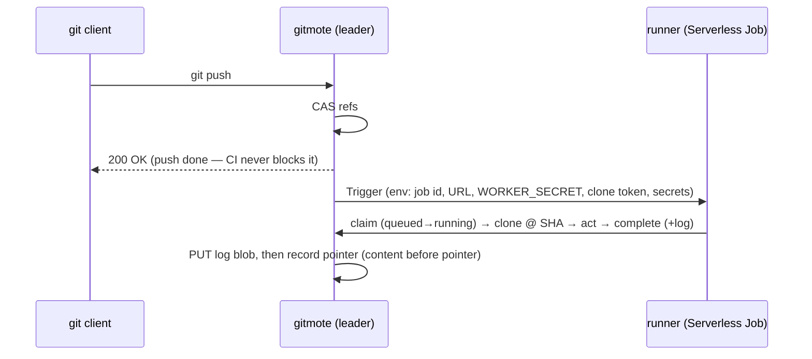

# CI

gitmote runs a repo's `.gitmote/workflows` on push. After a successful ref
advance, it runs each workflow in an isolated container. It keeps the logs,
reports pass or fail, and shows the status in the UI.

CI is deliberately limited. It still covers about 80% of personal CI:

- run on push
- run steps in a container
- report pass or fail
- keep logs

It has none of these:

- matrix builds
- a marketplace
- service containers
- caching

The engine is [`act`](https://github.com/nektos/act). It runs GitHub-Actions YAML,
so a workflow written for Actions runs unchanged under gitmote's runner. Actions
compatibility is a requirement, not a preference. When gitmote cannot run CI, the
GitHub mirror can: move the same YAML to `.github/workflows`, and GitHub runs it.

## Workflow directory

GitHub reads only `.github`. So the directory of a workflow declares which forge
runs it. A repo mirrored to GitHub uses the two directories this way:

- A workflow in `.gitmote` runs only on gitmote.
- A workflow in `.github` runs only on GitHub.

So no workflow runs on both forges. gitmote's own repo keeps its GitHub publish
pipeline in `.github`, so that pipeline never runs on gitmote.

`act` reads the directory through `--workflows`. The YAML is byte-identical to
GitHub's, so the switch is only a move of the file between the two directories.

## Pipeline

The trigger is the ref CAS commit ([request-flows.md](request-flows.md)). It is
the one durable moment when a ref advances. After it succeeds, an after-commit
callback dispatches the run, fire-and-forget. So a dispatch failure is a missed
run, not a failed push. This generalizes the content-before-pointer rule.

The runner ([`internal/runner`](../../internal/runner)) makes one linear pass:

1. claim
2. clone
3. act
4. complete

It holds only a scoped clone token and the injected
secrets. It reports over the authenticated API. It never touches s3lite or S3
directly.

### Branch filters

Branch filters gate dispatch, as on GitHub. The dispatcher parses the `on.push`
of each workflow. It records a run only for workflows whose branch filter selects
the pushed branch. So a push that matches no workflow produces no run at all.
GitHub also shows no workflow run when a push triggers nothing.

Without this rule, such a push would make a green no-op run. Its log would hold
only the start-up output of the engine, which is noise. gitmote's own `deploy.yml`
is the example. It is gated on `self-deploy`, and must stay silent on every
`master` push.

The dispatcher models the common subset of filters, about 80% of real use. That
subset is `branches` and `branches-ignore`, with `*` and `**` globs. The
dispatcher handles other cases this way:

- It ignores `paths` and tag filters. It keeps a workflow that uses them, and so
  errs toward running it.
- It does not model the rarer `?`, `+`, `[]` and `!` patterns. Such a pattern
  matches only its literal form.
- It keeps a workflow file that it cannot read or parse. So a malformed workflow
  shows as a failed run, and does not vanish.

## One runner, three substrates

The runner code and its env contract are the same everywhere. Only what starts a
job differs. The server selects it at boot
([`cmd/gitmote/main.go`](../../cmd/gitmote/main.go)):

| Condition | Trigger | Runs where |
| --- | --- | --- |
| `SCW_CI_JOB_DEFINITION_ID` set | Scaleway Serverless Jobs ([`internal/scaleway`](../../internal/scaleway)) | The cloud, as an ephemeral Job that scales to zero |
| Otherwise, `GITMOTE_URL` set | `LocalTrigger`, which runs the runner binary locally | A dev machine (`make dev`) |
| Neither | `NoopTrigger` | Nowhere: runs show in the UI, but do not execute |

So `make dev` exercises the whole path locally, with the same runner, API and
`act`.

Both executing triggers use `WORKER_SECRET`. It comes from the env, or gitmote
generates it and keeps it in the metadata database. The cloud trigger needs
`GITMOTE_URL` too, and the server refuses to start without it. A trigger that the
runner cannot report back to is a misconfiguration.

### act runs self-hosted on Scaleway, and nested locally

Serverless Jobs have no Docker daemon. So on the cloud runner, `act` runs in
self-hosted mode (`GITMOTE_ACT_PLATFORMS` in
[`Dockerfile.runner`](../../Dockerfile.runner)). Steps run directly in the
ephemeral Job container. The Job is the sandbox, and there is no Docker-in-Docker.
So the runner image must hold every tool a workflow needs, for example:

- git
- node
- bash

Locally, a real daemon exists. There, `GITMOTE_ACT_PLATFORMS` is unset, and `act`
keeps its default behavior of nested containers.

## Data model

Three tables in [`internal/meta`](../../internal/meta) hold the CI state:

- `ci_runs`
- `ci_jobs`
- `ci_secrets`

They are leader-only, and litestream replicates them.

Logs are append-only blobs under the `ci/` key space of the storage root, at
`ci/{repoID}/{runID}/{jobID}.log`. gitmote PUTs a log before it records the
`ci_jobs` pointer. A size cap bounds each log. Over the cap, gitmote truncates the
log with an explicit marker, never silently.

The runner reports through an API under `/internal`, apart from the browser UI
([`internal/ci/report.go`](../../internal/ci/report.go)):

| Route | Action |
| --- | --- |
| `GET /internal/ci/jobs/{id}` | Claims a job (`queued→running`). |
| `POST …/log` | Appends a chunk of the live log (see Live logs). |
| `POST …/complete` | Uploads the log and sets a terminal status. It is idempotent. |

Each route compares `WORKER_SECRET` in constant time. Only the leader writes
completions, and a follower returns a retryable 503. A leader-only reconcile
ticker sweeps jobs stuck in `running` to `error`.

## Live logs

The runner uploads the durable log once, at completion. So the durable log
cannot show the output of a running job. A best-effort live tail shows that
output. The live tail does not touch the durable path:

1. The runner tees the combined output of `act`. About every 1 s, it POSTs the
   new output to `…/log`.
2. The leader appends it to an in-memory buffer for the job
   ([`LiveLogs`](../../internal/ci/livelogs.go)). A cap bounds the buffer, as for
   the durable blob.
3. The job-log page of the UI polls
   `GET /{repo}/runs/{id}/job/{jid}/log/live?offset=N`, which returns
   `{bytes, next, done}`.
4. On `done`, the page reloads to the rendered durable log.

gitmote deliberately never replicates or persists the live tail. A lost chunk or
a leader restart only interrupts the live view. The runner still uploads the
whole log at completion, so the durable record does not change. This follows the
fire-and-forget rule: the tail is a convenience, never a correctness path.

The buffer is leader-only, because the browser polls the same instance that the
runner streams to. The reconcile tick sweeps a buffer after a short idle TTL.

## Secrets

gitmote encrypts per-repo CI secrets at rest. It decrypts them only to inject
them at trigger time. [safety.md §5](safety.md) gives the crypto and its narrow
threat model:

- AES-256-GCM under a master key that the server holds
  (`GITMOTE_CI_SECRET_KEY_V<n>`)
- a per-repo HKDF subkey
- AAD that binds `(repoID, name, version)`

The encryption protects against a leaked S3 replica or DB snapshot. It does not
protect against a compromised running server, which must hold the key to decrypt.

The dispatcher passes each secret as `GITMOTE_CI_SECRET_<NAME>`. The runner
forwards it to `act` as `-s <NAME>`, and `act` reads the value from its env. So
the value never touches the argv of `act`. The workflow sees `${{ secrets.NAME }}`,
as on GitHub. In the UI, values are write-only: the UI shows only the names.
gitmote never logs the values.

### Secrets from the env

The dispatcher has a second source of secrets, beside the encrypted secrets of the
UI and database. It overlays per-repo secrets from the server's own env, named
`GITMOTE_REPO_SECRET_<REPO>__<NAME>`. In `<REPO>`, the repo name is upper case,
with each `-` as `_`.

These secrets are plain operator config. gitmote never stores or encrypts them,
and they need no master key. So the UI does not show them, and they win over a DB
secret of the same name. The host env is already the CI trust boundary
([safety.md §5](safety.md)), so they add no exposure.

They exist for the automated self-deploy (`make self-deploy`). It carries its
Scaleway and GHCR secrets in a gitignored `.env`, not in the UI.

## Clone auth

The runner clones over ordinary git-HTTPS, with a token that the leader mints at
dispatch. The token is read-only, scoped to one run and one repo, and it expires.
This is the same authenticated path as for any client, with no CI backdoor.

The runner checks the SHA out onto its branch (`checkout -B`), so `github.ref`
resolves.

## Safety

- **Untrusted code execution.** Repo workflows are attacker-controlled. The
  Serverless Job is the isolation boundary. The writer never runs repo code, and
  the runner cannot reach s3lite or S3.
- **Fire-and-forget.** Dispatch and trigger never fail or block a push.
- **Single writer.** Only the leader dispatches and writes run state.

## Container image builds

Image builds depend on the substrate, and they are off by default.

### Scaleway cannot build

The Serverless Job sandbox has no user namespaces. It also drops the capabilities
that image builders need. So each of these fails as a step:

- `docker build`
- `buildah`
- `podman build`
- kaniko

On the cloud runner, CI can do these steps in any language:

- compile
- test
- lint
- produce file artifacts

It cannot build an OCI image. Such a step must run on the GitHub mirror,
which is a real builder. For the static-binary case, the step can instead assemble
the image through the registry API, with `ko` or `crane`.

### Local and VPS hosts can build, behind an opt-in

On a host with a daemon, `act` runs in nested mode. By default, it mounts the
host Docker socket into each job container, so `docker build` reaches the daemon.
That gives untrusted workflow code the daemon, which is host root. So gitmote
suppresses the mount (`act --container-daemon-socket -`) unless
`GITMOTE_CI_ALLOW_BUILDS` is true.

Turn the opt-in on only for trusted repos, on a host you control. With it on,
gitmote builds container images locally or on a VPS, its own image included.

`DOCKER_HOST` selects the runtime:

- Docker works with no setup.
- Podman needs its API socket service running (`podman system service`), with
  `DOCKER_HOST` pointed at it.
- A podman with no daemon at all cannot back `act`.

When builds are on, gitmote mounts the socket path that the daemon sees. That path
is `/var/run/docker.sock`, or the value of `GITMOTE_ACT_DAEMON_SOCKET`. gitmote
does not let `act` derive the mount from `DOCKER_HOST`. For a VM-backed daemon,
such as colima or Docker Desktop on macOS, `DOCKER_HOST` is a host path. The
daemon in the VM cannot resolve that path, so the socket mount would fail. See
[configuration.md](../configuration.md#image-builds).

### Without a daemon, every run fails visibly

`act` needs a reachable Docker or podman daemon to start job containers. On a host
without one, each CI job is still dispatched and recorded. Then it fails at the
"Set up job" step of `act`. The log reads
`failed to connect to the docker API … check if … the daemon is running`.

gitmote marks the run as failed, because `ActEngine.Run` returns `passed=false`.
No workflow step runs, and no build. The build opt-in matters only where a daemon
exists.

## Limitations

### gitmote does not deploy itself on Scaleway

gitmote has no cloud self-deploy loop, in which a green `master` run rebuilds
gitmote's own image in the Job. The Serverless Job cannot build (see above).
GitHub Actions builds the public image and pushes it to GHCR
(`ghcr.io/atmin/gitmote`), through
[`.github/workflows/ci.yml`](../../.github/workflows/ci.yml). It deploys nothing.
An operator runs `scw container update`, which pulls the new image
([deploy-scaleway.md](../deploy-scaleway.md#deploy)). The leased writer keeps the
swap safe (see [configuration.md](../configuration.md#rolling-deploys)).

### A local instance can deploy gitmote

A local instance is a real builder. So it can build and deploy gitmote, and
`make self-deploy` automates this:

1. It runs a throwaway instance with `GITMOTE_CI_ALLOW_BUILDS` on.
2. It seeds the deploy secrets from a gitignored `.env`, per repo, through
   `GITMOTE_REPO_SECRET_<REPO>__<NAME>`. gitmote never stores them, and they need
   no master key.
3. It pushes `HEAD` to `self-deploy`.

The push triggers
[`.gitmote/workflows/deploy.yml`](../../.gitmote/workflows/deploy.yml), gated on
`self-deploy`. It has three steps:

1. It builds the amd64 image.
2. It pushes the image to GHCR.
3. It runs the `scw container update` of a deploy by hand.

The workflow runs only on the `self-deploy` branch, and never tags `:master`. The
same writer lease makes its rolling swap safe. See
[deploy-scaleway.md](../deploy-scaleway.md#self-deploy-without-github).

### CI builds the runner image

Nobody builds the runner image by hand. A change on `master` to
[`Dockerfile.runner`](../../Dockerfile.runner) or to the runner source triggers a
build, and so does a release.
[`.github/workflows/publish-runner.yml`](../../.github/workflows/publish-runner.yml)
then publishes `ghcr.io/atmin/gitmote-runner` publicly. The Scaleway Job
definition references that GHCR image, and pulls it anonymously.
