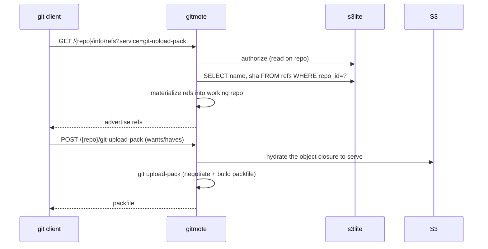
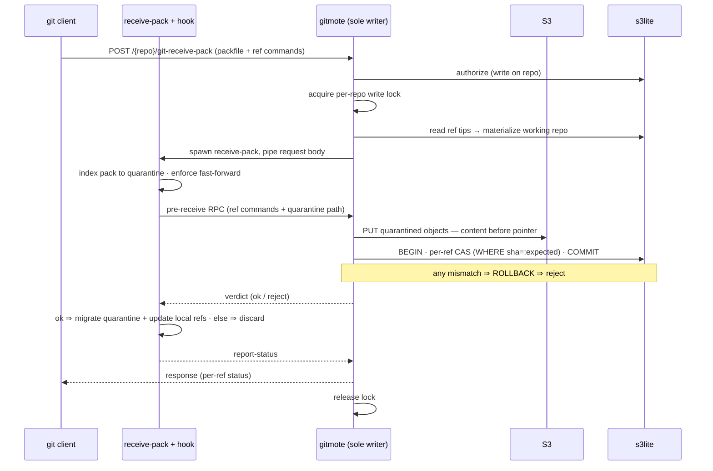

# Request flows

This file is part of the [gitmote architecture](README.md). It shows the read
path and the write path of a git request.

## Clone and fetch: the read path

A read takes no lock. The refs come from s3lite. gitmote hydrates the object
closure to serve from S3.

## Push: the write path and the CAS

A per-repo mutex in the process serializes pushes. The order of two steps is
critical for safety:

1. The objects become durable in S3.
2. Then the ref compare-and-swap (CAS) runs in s3lite.

One fact shapes the whole design. `git receive-pack` itself updates the refs and
acknowledges the client, at the end of its run. So the durable commit cannot
happen after receive-pack returns, because the acknowledgement has already gone
out.

The commit must happen inside the run of receive-pack. receive-pack has one hook
point designed for this: the `pre-receive` hook.

## Why the push works this way

### `pre-receive` is the transaction boundary

The hook runs with every `<old> <new> <ref>` command, before any ref changes. At
that point, the pushed objects sit in a quarantine directory
(`$GIT_QUARANTINE_PATH`).

When the hook exits non-zero, git rejects the whole push and discards the
quarantine. So a failed S3 PUT or CAS leaves nothing behind in the repo on disk.
At worst, orphan objects stay in S3.

The quarantine also holds exactly the new objects. So to PUT the new objects,
gitmote PUTs the contents of the quarantine.

### The hook calls back to the parent

The hook cannot touch s3lite directly. It runs as a child of `receive-pack`, in a
separate process. s3lite is a single-writer SQLite, embedded in the parent. The
one thing s3lite forbids is two processes that write to it.

So the hook calls the parent back over a unix socket. The parent is the sole
writer. It runs the PUT and the CAS, and returns a verdict. GitLab, through
Gitaly, connects its git hooks back to the app in the same way.

The channel has three parts:

- Installation. One hook binary, `gitmote-hook`, serves every repo.
  `core.hooksPath` refers to it. gitmote sets that value with `GIT_CONFIG_*` for
  each `receive-pack` it spawns. So every materialized repo has the hook, and no
  repo needs its own install.
- Discovery and auth. The parent puts the socket path (`GITMOTE_SOCK`) and a
  single-use nonce (`GITMOTE_NONCE`) into the environment of `receive-pack`. The
  parent mints the nonce for each push, and binds it to the locked operation. The
  nonce works once: its first use deletes it. So a stray local process cannot
  forge a ref update.
- Fail closed. Any error on the hook side rejects the push. Examples are:
  - a missing env var
  - a failed dial
  - a bad verdict

### One SQL transaction makes a push of many refs atomic

All the per-ref CAS checks run inside one s3lite transaction. So the push
succeeds or fails as a whole, as with `git push --atomic`. This is stronger than
refs stored as loose files.

### The local refs are disposable

On an `ok` verdict, receive-pack moves the quarantine into the repo and updates
the refs on disk. This is only bookkeeping on a disposable disk. S3 and s3lite
hold the durable state.

The fast-forward check tests ancestry, so it needs the history of the target
branch on the local disk. So a write hydrates that history first. This is the
limit on scale for large repos.
